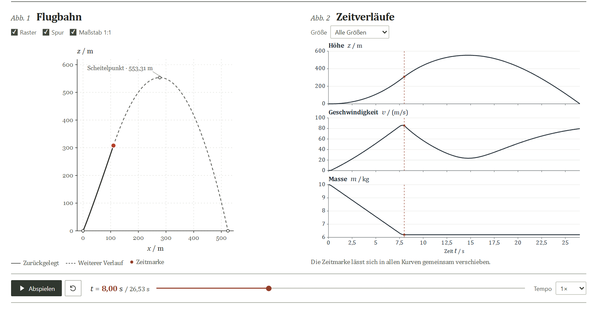

# FlightSim Lab

[2D-Fluganalyse im Browser öffnen](https://chabane95.github.io/flightSim-lab/)



Für die Offline-Ansicht lade das Repository herunter, entpacke es und öffne [index.html](index.html) im Browser. Die mitgelieferte Simulation lässt sich ohne Python auswerten.

## Flugbahn und Messreihen lesen

Die deutschsprachige Ansicht zeigt einen simulierten Raketenflug in der vertikalen x-z-Ebene. In der Standardeinstellung entspricht ein Meter auf beiden Achsen derselben Bildschirmlänge. Die durchgezogene Spur zeigt den bisherigen Flug, die gestrichelte Kurve seinen weiteren Verlauf.

Neben der Flugbahn, auf schmalen Bildschirmen darunter, zeigen drei übereinanderliegende Diagramme die Höhe, die Geschwindigkeit über Grund und die Masse auf einer gemeinsamen Zeitachse. Jede Größe lässt sich auch einzeln ansehen. Die Messwerttabelle gibt die Werte zum gewählten Zeitpunkt an.

- Mit **Abspielen** läuft die Zeit in allen Ansichten synchron. Die Zeitleiste und ein Klick in den Zeitverlauf wählen einen einzelnen Zeitpunkt aus.
- Über die **Flugereignisse** springst du direkt zu Start, Brennschluss, Scheitelpunkt oder Bodenkontakt.
- Die Leertaste startet und pausiert die Wiedergabe. Die Pfeiltasten links und rechts verschieben den Zeitpunkt um 0,25 s, mit gedrückter Umschalttaste um 1 s. Pos1 und Ende springen an die Grenzen der Messreihe.

## Modell und Referenzflug

Der [Python-Solver](2d_sim/main.py) integriert die horizontale und vertikale Bewegung mit dem Runge-Kutta-Verfahren vierter Ordnung. Der Referenzlauf verwendet einen Zeitschritt von 5 ms. Der Export übernimmt etwa alle 50 ms einen Stützpunkt sowie die Stützpunkte an den Flugereignissen. Dazwischen interpoliert die Browseransicht linear.

| Ereignis | Flugzeit | Horizontale Position | Höhe |
| --- | ---: | ---: | ---: |
| Brennschluss | 8,00 s | 110,08 m | 307,93 m |
| Scheitelpunkt | 14,73 s | 277,37 m | 553,31 m |
| Bodenkontakt | 26,53 s | 523,77 m | 0,00 m |

Während des Schubaufbaus sinkt die berechnete Höhe kurz rund 3 cm unter das Bodenniveau. Der Lauf endet beim erneuten Erreichen des Bodens. Die dort angezeigte Geschwindigkeit gilt für den Moment des Kontakts. Das frühere [1D-Modell](1d_sim/README.md) ist separat [dokumentiert](doc.md).

## Flug neu berechnen

Führe mit Python 3 im Stammverzeichnis des Repositorys diese Befehle aus.

```sh
python -m pip install numpy
python 2d_sim/main.py
```

Der Solver aktualisiert die Messreihe und öffnet die lokale Browseransicht. Mit `python 2d_sim/main.py --export` erzeugst du nur die Flugdaten. Für die klassische Animation installiere zusätzlich `matplotlib` und starte `python 2d_sim/main.py --matplotlib`.

## GitHub Pages aktualisieren

Die öffentliche Seite verwendet den Branch `gh-pages`. Wer Schreibzugriff hat, kann nach dem Commit der Änderungen auf `main` beide Branches aktualisieren. Die Pushes setzen voraus, dass die entfernten Branches per Fast-Forward aktualisiert werden können.

```sh
git push origin main
git push origin main:gh-pages
```
