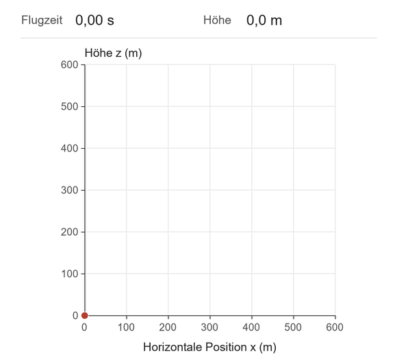

# FlightSim Lab

FlightSim Lab ist mein Lernprojekt für Python und Flugphysik. Mich interessiert, wie aus ein paar Bewegungsgleichungen eine sichtbare Flugbahn wird. Im ersten Versuch habe ich nur die Höhe einer Rakete berechnet. In der zweiten Version kam die seitliche Bewegung dazu.



Am höchsten Punkt sieht man gut, was die zweite Dimension ausmacht. Die Rakete hört für einen Augenblick auf zu steigen, bewegt sich aber weiter nach rechts. Die Linie zeigt, wo sie in der Simulation schon war. Die Uhr im Bild zeigt die simulierte Flugzeit.

## Selbst ausprobieren

Im [Lernskript](LERNSKRIPT.md) kannst du den Weg vom Bild zum Code mitgehen. Du liest einen Flugzustand, rechnest einen kleinen Zeitschritt selbst und vergleichst deine Antwort mit dem Programm. Wenn du beim ersten Versuch anfangen möchtest, findest du hier das [ursprüngliche 1D-Modell](1d_sim/main.py).

Das GIF oben kannst du direkt auf GitHub ansehen. Um es selbst zu erzeugen, führe im Projektordner mit Python 3 diese beiden Befehle aus.

```sh
python -m pip install -r requirements.txt
python 2d_sim/main.py
```

Der zweite Befehl berechnet den Flug und schreibt die Animation nach `media/flugbahn.gif`.

## Wie es weitergeht

Als Nächstes möchte ich besser prüfen können, ob die Rechnung stimmt. Dafür bietet sich ein einfacher Fall an, dessen Lösung man auf Papier kennt. Dann lässt sich sehen, wie groß der Fehler bei verschiedenen Zeitschritten ist. Im [Ausbauplan am Ende des Lernskripts](LERNSKRIPT.md#ausbauplan) steht, wie daraus nach und nach ein verlässlich getestetes und für andere nachvollziehbares Projekt werden kann.
